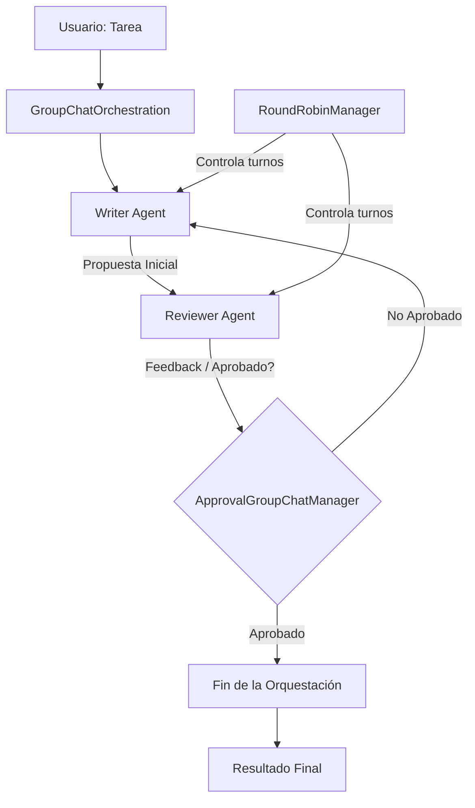
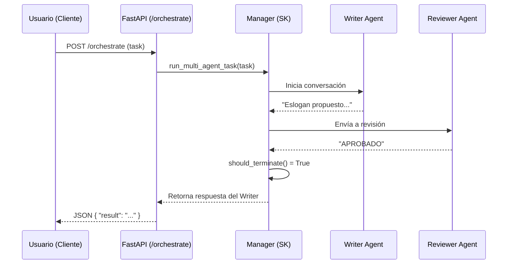

# Architecture Design - Multi-Agent SK

## 1. Flujo de Orquestación (Group Chat)

## 2. Flujo de una Petición HTTP (FastAPI)

3. Componentes de Software

- **API Layer** (`app/main.py`): FastAPI. Expone los endpoints y maneja la concurrencia.
- **Agent Engine** (`app/agents/manager.py`): Configura la orquestación, los agentes y el manager de control.
- **Agents** (`writer.py`, `reviewer.py`): Definen la personalidad, instrucciones y el servicio de LLM a utilizar.
- **LLM Factory** (`app/core/llm_factory.py`): Patrón Registry para instanciar el proveedor de IA (OpenRouter).